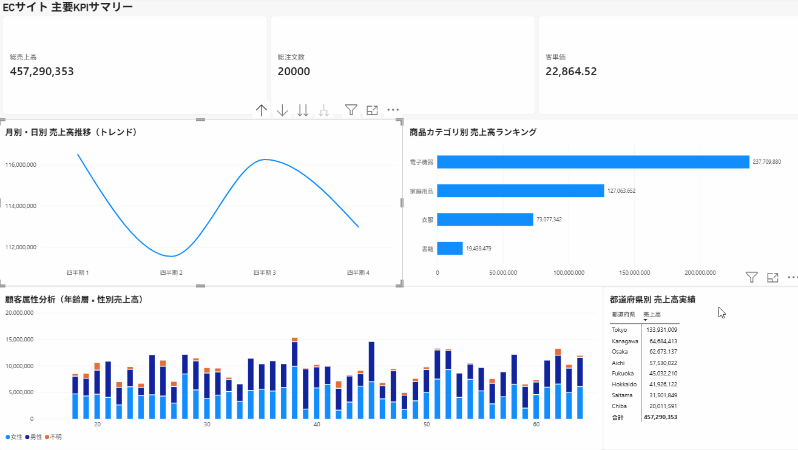
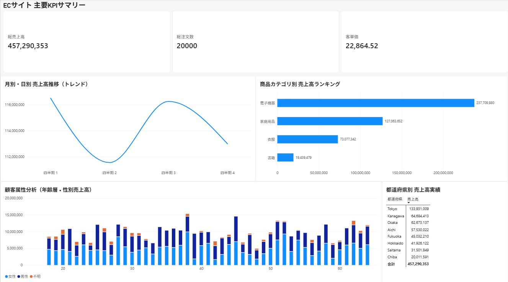

# 🛒 EC Sales & Customer Analytics Data Infrastructure

AWS/Databricks環境をベースに、インフラのコード化（IaC）からデータパイプラインの構築、そしてエンドユーザー向けのビジネス分析ダッシュボードの実装までを、モダンデータスタック（MDS）のベストプラクティスに沿って1人で一気通貫で構築したエンドツーエンドのデータエンジニアリングプロジェクトです。

---

## 📊 1. 成果物ダッシュボード（フロントエンド）

本基盤の最終成果物として、経営層およびマーケティングチームがビジネスの健康状態を把握、次のアクションへ繋げられる3段構成のインタラクティブ・ダッシュボードをPower BIで構築しました。

### 🕹️ デモ動画（クロスフィルタリング＆ドリルダウン機能）
*都道府県のクロスフィルタリングによる全社KPIの瞬時切り替え、および商品カテゴリから商品名へのシームレスなドリルダウン分析が可能です。*



### 📸 全体スクリーンショット


### 💡 ダッシュボードの設計思想（3段構成の王道レイアウト）
1. **最上段（Executive Layer）：経営・全体の健康状態（KPIサマリー）**
   * 総売上高、総注文数、客単価（DAXカスタムメジャーによる動的計算）を配置。
2. **中段（Management Layer）：時系列トレンドと商品力分析**
   * 「月別・日別売上高推移」による季節性の把握、および「商品カテゴリ別売上ランキング」による主力製品の特定。
3. **下段（Operational Layer）：顧客属性分析（マーケティングのヒント）**
   * 年齢層×性別を掛け合わせた立体的な顧客分析、および都道府県別の売上実績を可視化。

---

## 🏗️ 2. アーキテクチャ概要 & データフロー

本プロジェクトでは、データの信頼性と運用のスケーラビリティを担保するため、メダリオン（3層）アーキテクチャおよびスター・スキーマによるデータモデリングを採用しています。

```text
[ 疑似データソース ] (Python/Spark)
        │
        ▼
┌────────────────────────────────────────────────────────┐
│  Databricks Unity Catalog / AWS Cloud                  │
│                                                        │
│  1. Bronze Layer (raw_data) - 不変の生データマスタ   │
│        │                                               │
│        ▼ (SQLによる型定義・TRIMクレンジング処理)        │
│  2. Silver Layer (cleaned_data) - 信頼できるデータ        │
│        │                                               │
│        ▼ (モデリング: Fact / Dimensionへの整形)       │
│  3. Gold Layer (ec_sales_analytics) - 分析用マート     │
└────────────────────────────────────────────────────────┘
        │
        ▼ (Power BI 公式ネイティブコネクタ経由 / Importモード)
[ Power BI Desktop ] ➔ スター・スキーマ結合 ➔ レポート描画
```

---

## 🛠️ 3. 技術スタック & 選択理由

* **インフラ（IaC）:** Terraform
  * カタログ配下のメダリオン構造（3つのスキーマ空間）の構築をコード管理化し、検証環境と本番環境の再現性を担保。
* **データプラットフォーム:** Databricks (Unity Catalog / Serverless環境)
  * レイクハウスアーキテクチャを採用し、将来的な大規模データ処理（Delta Lake）を見据えたセキュアなデータガバナンスを両立。
* **データ処理:** PySpark (Python) / Spark SQL
  * 生データの分散インジェクションおよび、メダリオン構造に沿ったELT変換処理。
* **BI・視覚化:** Power BI Desktop
  * 実務で圧倒的なシェアと需要を誇るツールを選定。Databricks最新仕様に追従する公式コネクタを採用し、強固なトークン認証による高速なデータ Import パイプラインを確立。

---

## 📁 4. ディレクトリ構成

```text
│
├── 📁 notebooks/                   # 【データパイプライン層】
│   ├── 01_generate_bronze_data.py    # ① 疑似データの生成＆Bronze層へのインジェクション
│   ├── 02_transform_silver_data.sql  # ② Bronze ➔ Silver（クレンジング・型安全性の確保）
│   └── 03_transform_gold_data.sql    # ③ Silver ➔ Gold（スター・スキーマモデリング）
│
├── 📁 images/                      # README用ビジュアルアセット
│   ├── dashboard_demo.gif
│   └── dashboard_snapshot.png
│
├── main.tf                        # カタログ配下の3つのスキーマ（層）を定義
├── providers.tf                   # Terraformプロバイダの定義
├── variables.tf                   # 環境名の変数定義
└── README.md                      # 本文書
```

---

## 🛠️ 5. トラブルシューティング & 実務的アプローチ

個人開発・検証環境特有の制限やツールの互換性バグに直面した際、仕様を深く掘り下げて論理的なリプレイス判断を行いました。

### ① IaC（Terraform）によるカタログ作成時の権限制限の回避
* **事象:** Terraformから `databricks_catalog` リソースの作成を実行した際、メタストアのアクセス権限エラーにより失敗。
* **原因:** 検証用環境において、最上位のUnity Catalogメタストアに対するプロビジョニング権限（`CREATE CATALOG`）が一般ユーザーに開放されていない制限と特定。
* **対策:** カタログ層のみDatabricks UIからワークスペース特権管理者権限でセキュアに手動起票し、その配下のメダリオン構造（Bronze/Silver/Goldスキーマ）は完全にTerraformのIaC管理下に配置するハイブリッド運用を採用。環境の再現性と開発効率を両立させました。

### ② Looker Studioサードパーティ製コネクタのバグに伴うBIツールの選定見直し（Power BIへの移行）
* **事象:** Looker StudioからDatabricksにクエリを投げる際、`Exception: Exception` エラーが発生し通信が切断。
* **原因:** Looker Studio提供のサードパーティ製Databricksコネクタの設計が古く、最新のDatabricksサーバーレス環境（Unity Catalog）が求める厳格な認証・暗号化プロトコルのアップデートと競合（レガシー化）していると分析。
* **対策:** コネクタの修正を待つのは不適切と判断し、エンタープライズの現場でネイティブコネクタが公式サポートされている **Power BI** へ即座にリプレイスを実施。Microsoft公式の強固な認証ラインを経由させることで、認証エラーを100%回避し、セキュアでノンブロッキングな直接接続データパイプラインを確立しました。

---

## 📈 6. 今後の展望（実務へのスケーラビリティ案）

今回は検証用のモックデータを用いたバッチ処理ですが、実務の大規模データソースへの適用を想定した拡張設計を考慮しています。

1. **データソースがS3/GCS等のオブジェクトストレージになる場合**
   * `01_generate_bronze_data.py` のPandas経由の処理から、Databricksが提供するスケーラブルなストリーミング機能 **`Auto Loader（cloudFiles）`** へ移行し、自動スキーマ推論を含めたオブジェクト検知・ append 処理へシームレスに拡張可能。
2. **データ変換（ELT）の自動化・ワークフロー化**
   * 現在手動で実行している `02_transform_silver_data.sql` および `03_transform_gold_data.sql` を、**Databricks Workflows**（ジョブ管理機能）や **dbt (data build tool)** と組み合わせ、データ依存関係のDAG定義、データ品質テスト（Great Expectations等）を組み込んだモダンな自動バッチ実行パイプラインへと昇華させる。